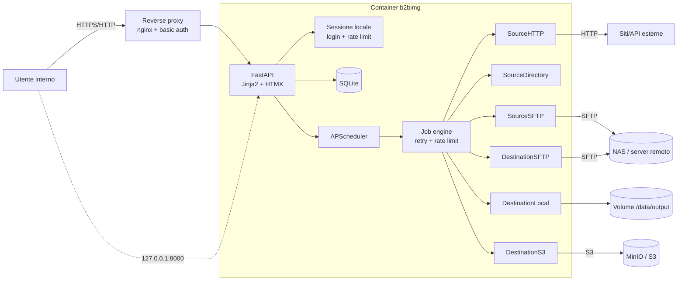

# b2bimg

Portale **interno e self-hosted** per la gestione e il download automatizzato delle
immagini prodotto a partire da un listino CSV. Interroga più *sorgenti* (endpoint
HTTP, directory locali, SFTP) per localizzare le immagini e le invia a una
*destinazione* configurabile (directory locale, SFTP, S3/MinIO).

> ⚠️ **Uso interno.** Il portale non è pensato per l'esposizione pubblica:
> richiede login, limita le richieste verso l'esterno e va pubblicato solo su
> `127.0.0.1` o dietro un reverse proxy con TLS e autenticazione.

---

## Funzionalità

- **Upload CSV** con validazione di header ed encoding (UTF-8 con/senza BOM, Windows-1252),
  autodetect del separatore e anteprima prima dell'import.
- **Filtri dinamici**: scelta del campo (dropdown dagli header del CSV) e selezione
  multipla dei valori con ricerca live.
- **Sorgenti a plugin**: `http`, `directory`, `sftp` — con timeout, retry (max 3),
  rate limiting per sorgente e **session reuse** tramite cookie da `.env` o file.
- **Destinazioni a plugin**: `local`, `sftp`, `s3` (MinIO/AWS) — con nome file
  configurabile (template con placeholder) e gestione conflitti
  (*sovrascrivi / rinomina / salta*).
- **Job asincroni** (APScheduler) con progress bar, stato per riga
  (`✓ scaricato`, `⚠ non trovato`, `✗ errore`), rilancio dei soli falliti e
  **report CSV** scaricabile.
- **Sicurezza**: login obbligatorio con sessioni scadenzabili, rate limiting,
  sanitizzazione dei path (anti path-traversal), nessun segreto nel codice.

## Stack

| Livello   | Tecnologia                                            |
|-----------|-------------------------------------------------------|
| Backend   | Python 3.12 · FastAPI · SQLAlchemy 2                |
| Frontend  | Jinja2 + HTMX (server-side, nessun build step)      |
| Database  | SQLite (PostgreSQL via `DATABASE_URL`)              |
| Job       | APScheduler (thread pool in-process)                |
| HTTP/SFTP | httpx · paramiko · boto3                            |
| Container | Docker multi-stage, utente non-root, healthcheck    |

---

## Architettura



Flusso: **upload CSV → filtro → sorgente + destinazione → avvio job → report**.
Ogni riga è registrata nel DB con stato, sorgente usata, dimensione e messaggio
d'errore; il job engine processa in background, con rate limiting condiviso per
sorgente e retry con backoff esponenziale.

```
.
├── app/                     # backend FastAPI
│   ├── main.py              # app factory, lifespan, scheduler, healthcheck
│   ├── config.py            # impostazioni da .env
│   ├── db.py, models.py     # SQLAlchemy: utenti, sessioni, job, righe
│   ├── security.py          # hashing PBKDF2, sessioni, rate limit login
│   ├── pathutil.py          # sanitizzazione path / anti path-traversal
│   ├── ratelimit.py         # token-bucket per sorgente
│   ├── routers/             # auth, dashboard, jobs (HTMX)
│   └── services/            # csv_service, filters, job_engine, report
├── plugins/
│   ├── base.py              # interfacce ImageSource / Destination + errori
│   ├── registry.py          # autoregistrazione dei plugin
│   ├── sources/             # http.py, directory.py, sftp.py
│   └── destinations/        # local.py, sftp.py, s3.py
├── templates/               # Jinja2 (+ HTMX partials)
├── static/                  # css + htmx.min.js (vendored, nessuna CDN)
├── tests/                   # pytest
├── examples/prodotti_esempio.csv
├── Dockerfile               # multi-stage
└── docker-compose.yml       # app + (profilo) reverse proxy
```

---

## Quickstart con Docker

```bash
git clone <URL_DEL_REPO> b2bimg && cd b2bimg
cp .env.example .env
# genera un segreto e imposta la password admin
python -c "import secrets; print(secrets.token_urlsafe(48))"   # incolla in SECRET_KEY
$EDITOR .env        # ADMIN_PASSWORD, SECRET_KEY, credenziali sorgenti/destinazioni

docker compose up -d --build
```

Apri **http://127.0.0.1:8000** ed effettua il login con `ADMIN_USERNAME` /
`ADMIN_PASSWORD`. La porta è pubblicata solo su `127.0.0.1`.

Per provare subito con la sorgente `directory`, monta una cartella di immagini
(nel `docker-compose.yml` c'è già `./images:/data/images:ro`) e nella
configurazione della sorgente usa `base_dir = /data/images`.

### Esposizione in rete (opzionale)

Il default pubblica la porta su localhost. Per l'accesso dalla rete interna,
usa il profilo `proxy` (nginx + basic auth):

```bash
# 1) crea il file delle credenziali basic auth
htpasswd -c docker/htpasswd utente        # richiede apache2-utils / httpd-tools
# 2) avvia anche il proxy
docker compose --profile proxy up -d
# 3) raggiungi http://<ip-del-server>:8080
```

Per TLS, termina HTTPS su un reverse proxy aziendale (o aggiungi certificati in
`docker/nginx.conf`) e imposta `SESSION_COOKIE_SECURE=true` nel `.env`.

### Sviluppo locale (senza Docker)

```bash
python3.12 -m venv .venv && source .venv/bin/activate
pip install -r requirements.txt -r requirements-dev.txt
cp .env.example .env && $EDITOR .env
uvicorn app.main:app --reload --host 127.0.0.1 --port 8000
```

---

## Variabili d'ambiente

Tutte le chiavi sono documentate in [`.env.example`](.env.example). Sintesi:

| Variabile | Default | Descrizione |
|---|---|---|
| `APP_HOST` | `127.0.0.1` | Interfaccia di bind (locale). In Docker: `0.0.0.0`. |
| `APP_PORT` | `8000` | Porta di ascolto. |
| `LOG_LEVEL` | `INFO` | Livello di log (`DEBUG`, `INFO`, `WARNING`…). |
| `TRUSTED_HOST` | `*` | Host ammessi (anti Host-header), separati da virgola. |
| `SECRET_KEY` | casuale | Firma dei token di sessione. **Impostala** per sessioni stabili. |
| `ADMIN_USERNAME` | `admin` | Utente creato al primo avvio. |
| `ADMIN_PASSWORD` | generata | Password admin; se assente ne viene generata una e loggata. |
| `SESSION_TTL_MINUTES` | `480` | Durata sessione (sliding). |
| `SESSION_COOKIE_SECURE` | `false` | `true` dietro HTTPS. |
| `LOGIN_MAX_ATTEMPTS` | `5` | Tentativi di login per finestra. |
| `LOGIN_WINDOW_SECONDS` | `300` | Finestra del rate limit di login. |
| `DATA_DIR` | `data` | Base per DB, upload, output. In Docker: `/data`. |
| `MAX_UPLOAD_MB` | `20` | Dimensione massima del CSV. |
| `MAX_IMAGE_MB` | `25` | Dimensione massima per immagine. |
| `SOURCE_RATE_LIMIT_PER_MIN` | `30` | Richieste/minuto per sorgente (0 = illimitato). |
| `SOURCE_DEFAULT_TIMEOUT` | `15` | Timeout di default (s) per sorgente. |
| `SOURCE_MAX_RETRIES` | `3` | Tentativi massimi per prodotto. |
| `DATABASE_URL` | SQLite | Es. `postgresql+psycopg://user:pass@db/b2bimg`. |
| `SORGENTE_HTTP_COOKIE`, `SFTP_PASSWORD`, `SFTP_KEY_FILE`, `AWS_*` | — | Credenziali referenziate nei form come `${NOME_VAR}`. |

---

## Formato CSV

- Prima riga = **header**. Separatore rilevato automaticamente (`,` `;` tab `|`).
- Encoding accettato: **UTF-8** (con/senza BOM) e **Windows-1252**.
- Header duplicati rinominati automaticamente; righe vuote ignorate.

```csv
codice,descrizione,categoria,fornitore
AB-1001,Tastiera meccanica,periferiche,Logitech
AB-1002,Mouse wireless,periferiche,Logitech
AB-2001,Monitor 27,monitor,Dell
```

Esempio pronto: [`examples/prodotti_esempio.csv`](examples/prodotti_esempio.csv).

Il **campo codice** (usato per cercare le immagini) è scelto nell'interfaccia e
viene proposto automaticamente su header come `codice`, `code`, `sku`, `ean`…

---

## Aggiungere un nuovo plugin

Tutti i plugin si autoregistrano tramite decoratore: non serve modificare il
core. Basta aggiungere il modulo e importarlo in `plugins/sources/__init__.py`
(o `destinations/__init__.py`).

### Nuova sorgente

```python
# plugins/sources/api.py
from plugins import ImageSource, FetchResult, NotFoundError, NetworkError
from plugins.registry import register_source
from plugins.base import FieldSpec

@register_source
class SourceAPI(ImageSource):
    type = "api"                     # identificatore univoco
    label = "API JSON interna"
    description = "Interroga un'API che restituisce l'URL dell'immagine."
    fields = (
        FieldSpec("endpoint", "Endpoint", required=True,
                  placeholder="https://api.interna/{codice}"),
        FieldSpec("token", "Token", type="password", env_hint="${API_TOKEN}"),
    )

    def fetch(self, product_code: str) -> FetchResult:
        url = self.build_url(product_code)          # helper tuo
        self.acquire_slot()                         # rate limiting condiviso
        # ... richiesta HTTP ...
        if not found:
            raise NotFoundError("immagine assente")
        if error:
            raise NetworkError("errore transitorio")  # -> verrà ritentato
        return FetchResult(location=img_url, content=body, content_type="image/jpeg")
```

Poi in `plugins/sources/__init__.py`:

```python
from plugins.sources import api  # noqa: F401
```

La sorgente comparirà automaticamente nel dropdown e il form dei parametri sarà
generato dai `FieldSpec`. I valori `${VAR}` vengono risolti dalle variabili
d'ambiente (mai salvati in chiaro nel DB).

### Nuova destinazione

```python
# plugins/destinations/webdav.py
from plugins import Destination, PutResult
from plugins.registry import register_destination
from plugins.base import FieldSpec

@register_destination
class DestinationWebDAV(Destination):
    type = "webdav"
    label = "WebDAV"
    fields = (FieldSpec("base_url", "Base URL", required=True),)

    def put(self, filename: str, data: bytes, conflict: str = "rename") -> PutResult:
        # rispetta `conflict`: overwrite | rename | skip
        return PutResult(path=f"/{filename}", action="created", size=len(data))
```

### Regole utili

- Solleva `NotFoundError` per "prodotto non trovato" (non viene ritentato) e
  `NetworkError` per errori transitori (ritentati fino a `SOURCE_MAX_RETRIES`).
- Usa `self.acquire_slot()` prima delle chiamate esterne per rispettare il rate limit.
- Sanifica sempre i nomi file con `app.pathutil.sanitize_filename` /
  `safe_join` prima di scrivere su disco.

---

## Test

```bash
pip install -r requirements-dev.txt
pytest -q            # 83+ test
ruff check .         # lint
```

I test coprono: parsing CSV (encoding/separatore/validazioni), filtri, plugin
sorgente e destinazione con mocking (httpx.MockTransport, paramiko/boto3 mock),
retry e job engine end-to-end, e il flusso web completo (login → upload → filtro →
config → avvio → report).

---

## Sicurezza

- **Login obbligatorio** su ogni rotta (eccetto `/login`, `/logout`, `/healthz`,
  `/static`); sessioni server-side con scadenza e token firmato.
- **Nessuna registrazione pubblica**: l'utente admin è creato al primo avvio.
- **Bind locale**: `127.0.0.1` di default; in Docker la porta è pubblicata solo su
  localhost, l'esposizione in LAN passa da un reverse proxy con basic auth.
- **Rate limiting** verso le sorgenti esterne (`SOURCE_RATE_LIMIT_PER_MIN`) e sui
  tentativi di login; `User-Agent` identificabile per non sembrare un attacco.
- **Anti path-traversal**: ogni lettura/scrittura su disco passa da
  `safe_join` / `sanitize_filename`; i nomi file sono derivati da template con
  placeholder controllati.
- **Segreti solo in `.env`**: i form dei plugin possono referenziare `${VAR}`.

## Note e limiti

- SQLite con WAL: adatto a un uso interno; per volumi elevati/concorrenza passare
  a PostgreSQL via `DATABASE_URL` (schema compatibile).
- Le migrazioni sono gestite da `create_all` all'avvio; per evoluzioni dello
  schema in produzione introdurre Alembic.
- I job girano in-process (APScheduler): un solo container basta; per scalare
  orizzontalmente sostituire lo scheduler con Celery + Redis.

## Pubblicazione su GitHub

Il progetto è già un repository Git locale con storia a commit convenzionali.
Per pubblicarlo:

```bash
# con GitHub CLI (crea il repo remoto e fa push)
gh repo create b2bimg --private --source=. --remote=origin --push

# oppure manualmente
git remote add origin git@github.com:<utente>/b2bimg.git
git branch -M main
git push -u origin main
```

Ricorda: `.env`, `data/`, immagini e report sono in `.gitignore` e non vanno
mai committati.

## Licenza

MIT — vedi `LICENSE`.
